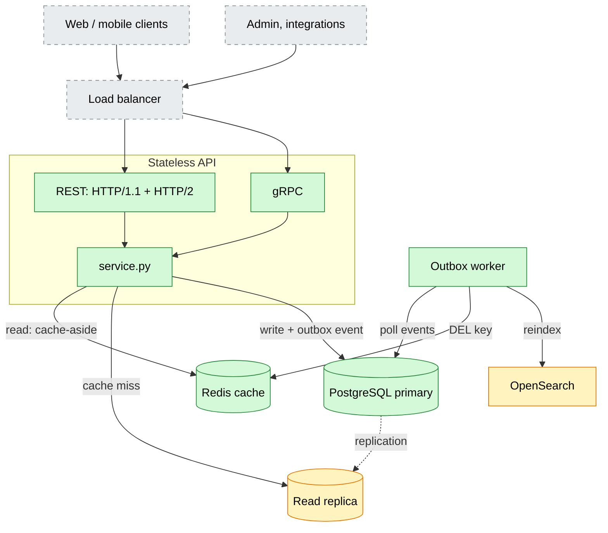
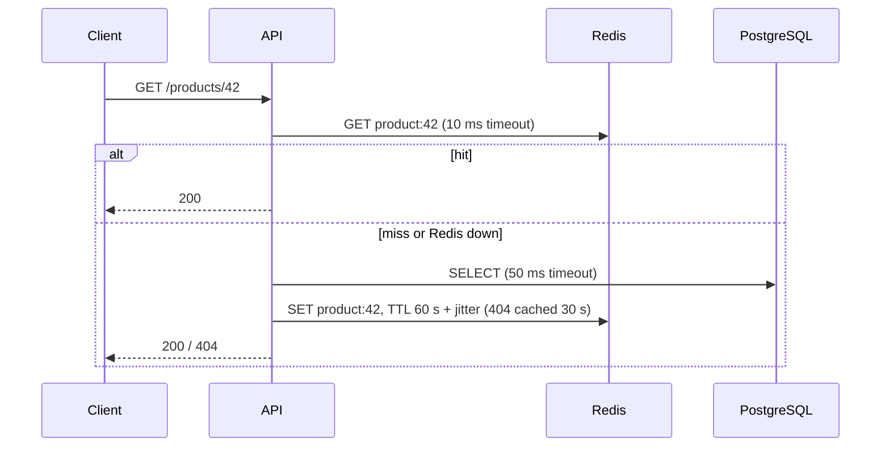
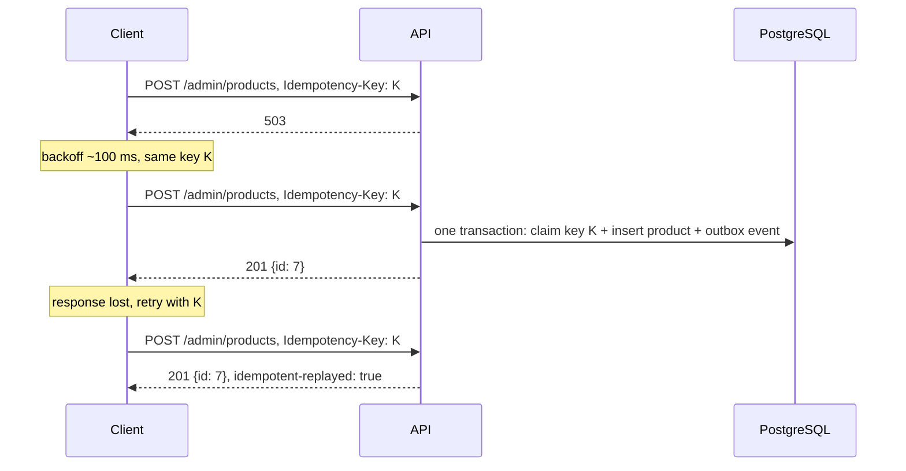

# SIS #2 — Product Catalog: REST vs gRPC

The product catalog from SIS #1, served over three protocols, with idempotency, timeouts and retries. Benchmark results are in [REPORT.md](REPORT.md).

| Variant | Port | Transport | Format |
|---|---|---|---|
| REST, HTTP/1.1 (baseline) | 8443 | TLS, ALPN `http/1.1` | JSON |
| REST, HTTP/2 | 8443 (same server) | TLS, ALPN `h2` | JSON |
| gRPC | 50051 | TLS, HTTP/2 | Protobuf |

**Stack:** Python 3.12, FastAPI + Hypercorn, grpc.aio, SQLAlchemy + asyncpg, Alembic, PostgreSQL 17, Redis 7.4.

## Run

```bash
uv sync
make up migrate seed   # PostgreSQL + Redis, schema, 10k products
make certs proto       # TLS certificate, gRPC code

make rest-tls          # REST  https://localhost:8443
make grpc              # gRPC  localhost:50051
make outbox            # outbox worker

make test              # integration tests
make bench             # benchmark -> benchmarks/
```

## Architecture

Green: implemented. Yellow: mocked. Grey: SIS #1 design only.



- **Read replica (mock):** reads use a separate pool (`READ_DATABASE_URL`), currently the same database.
- **OpenSearch (mock):** `FakeSearchIndex` receives reindex calls. Listing is served from PostgreSQL, the SIS #1 fallback mode.
- **Not deployed:** load balancer, CDN, S3, Kubernetes.

## Read: cache-aside



## Write: idempotency and retries



| | REST | gRPC |
|---|---|---|
| Idempotency key | `Idempotency-Key` header | `idempotency-key` metadata |
| Optimistic locking | `If-Match: <version>` → 412 | `expected_version` → `FAILED_PRECONDITION` |
| Retries | 3 attempts, 3 s total budget, on 502/503/504 | built-in `retryPolicy`, on `UNAVAILABLE` |
| Deadline | `X-Request-Timeout` → 504 | gRPC deadline → `DEADLINE_EXCEEDED` |
| Dependency failure | 503 + `Retry-After` | `UNAVAILABLE` |

## Project layout

```
app/
  api/          rest.py, grpc_server.py, generated gRPC code
  services/     service.py (business logic), search.py (OpenSearch mock)
  database/     db.py, models.py
  cache/        cache.py
  workers/      outbox_worker.py
  config.py  schemas.py  clients.py
proto/          catalog.proto
migrations/     Alembic
tests/          integration tests
bench.py        benchmark
```
