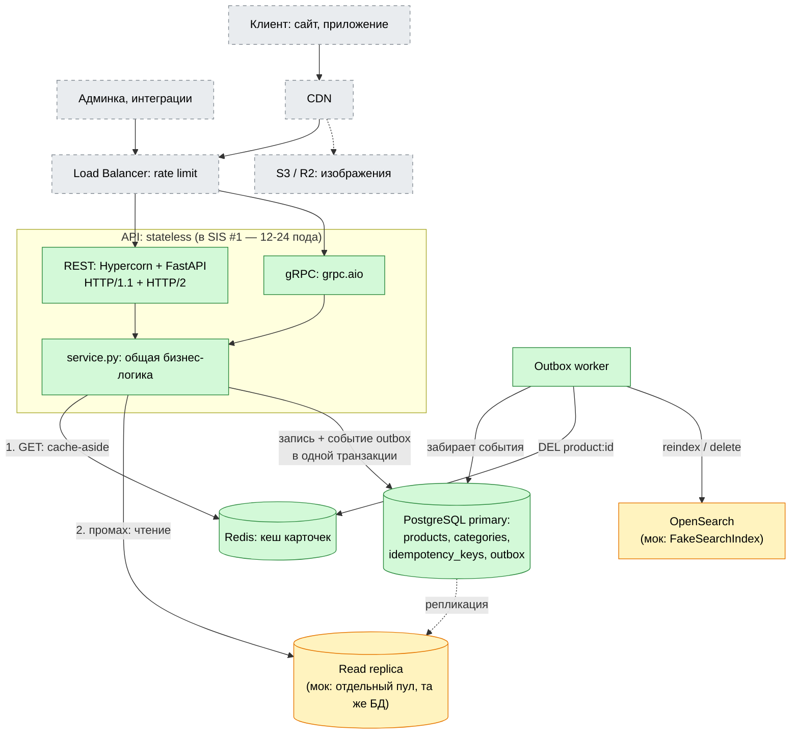
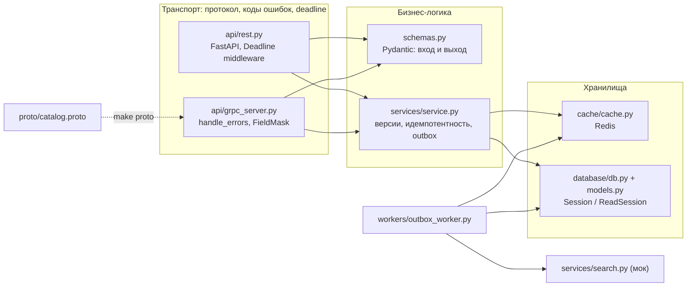
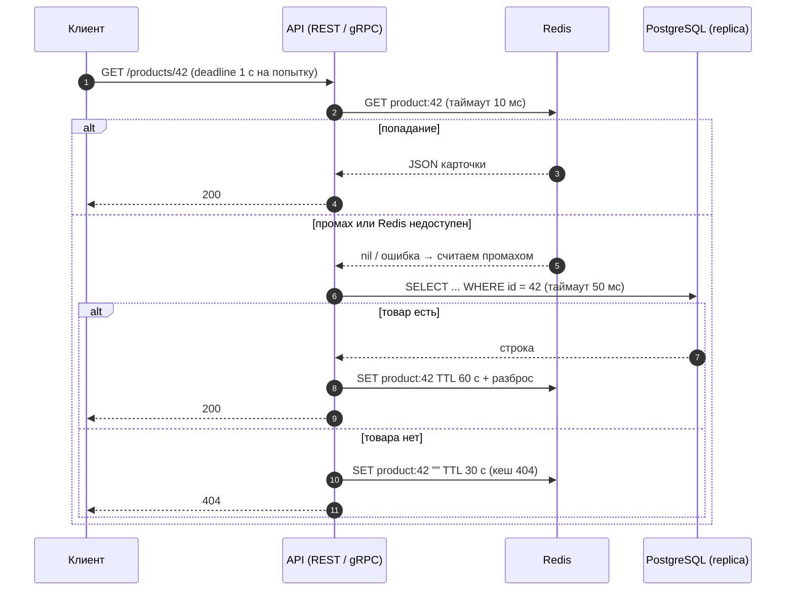
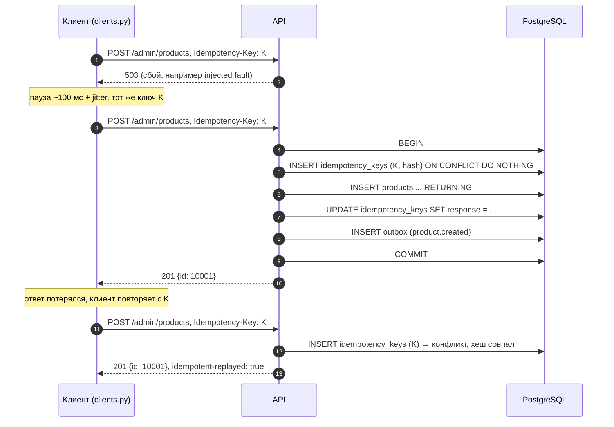
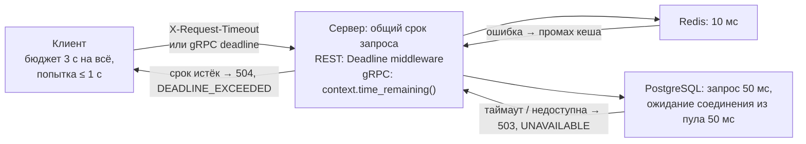
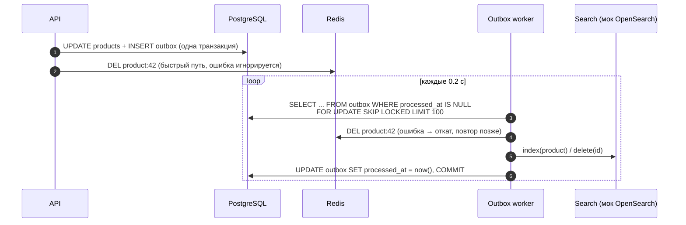

# SIS #2 — Product Catalog: REST (HTTP/1.1, HTTP/2) и gRPC

Каталог товаров из SIS #1, реализованный на трёх вариантах протокола с идемпотентностью, таймаутами и повторами. Результаты замеров и выводы — в [REPORT.md](REPORT.md).

| Вариант | Порт | Транспорт | Формат |
|---|---|---|---|
| REST, HTTP/1.1 — baseline | 8443 | TLS, ALPN `http/1.1` | JSON |
| REST, HTTP/2 | 8443 (тот же сервер) | TLS, ALPN `h2` | JSON |
| gRPC | 50051 | TLS, HTTP/2 | Protobuf |

Стек: Python 3.12, FastAPI + Hypercorn, grpc.aio, SQLAlchemy 2 + asyncpg, Alembic, Redis, pytest.

## Быстрый старт

```fish
uv sync
make up              # PostgreSQL (5432) + Redis (6380) в Docker
make migrate         # таблицы через Alembic
make seed            # 100 категорий, 10 000 товаров (make seed COUNT=1000000)
make certs           # самоподписанный TLS-сертификат для localhost
make proto           # Python-код из proto/catalog.proto

make rest-tls        # REST  https://localhost:8443  (HTTP/1.1 + HTTP/2)
make grpc            # gRPC  localhost:50051
make outbox          # outbox worker: инвалидация кеша + reindex

make test            # 27 интеграционных тестов (серверы поднимаются сами)
make bench           # замеры → benchmarks/results.csv, benchmarks/results.md
```

Для разработки без TLS: `make rest` → http://127.0.0.1:8000/docs.

## 1. Архитектура: SIS #1 и что реализовано

Схема из SIS #1. Зелёное — работает по-настоящему, жёлтое — мок, серое — только в дизайне (по согласованию с преподавателем инфраструктуру можно не поднимать).



| Компонент SIS #1 | Здесь |
|---|---|
| API (REST + gRPC), PostgreSQL, Redis, outbox + worker | реализованы |
| Read replicas | мок: `READ_DATABASE_URL` → отдельный пул `ReadSession`, по умолчанию та же БД. Все чтения уже идут через него, для настоящей реплики достаточно сменить URL |
| OpenSearch | мок: `app/services/search.py` (`FakeSearchIndex`), воркер вызывает `index` / `delete`. Список товаров строится из PostgreSQL — это fallback-режим из SIS #1 («OpenSearch down → list from Postgres») |
| Load balancer, CDN, S3, Kubernetes/HPA, 3 AZ | только в дизайне: один процесс REST и один gRPC |

## 2. Слои кода



Бизнес-правила написаны один раз в `service.py`. REST и gRPC только переводят запрос в общие модели и исключения сервиса — в коды ответа (`NotFound` → 404 / `NOT_FOUND`, `VersionMismatch` → 412 / `FAILED_PRECONDITION`, и т.д.).

## 3. Чтение карточки: cache-aside и таймауты



- **Разброс TTL** защищает от одновременного истечения многих ключей (avalanche), **кеш 404** — от запросов к несуществующим id (penetration).
- **Redis недоступен** → любая ошибка превращается в промах, каталог работает напрямую от PostgreSQL.
- **PostgreSQL не ответил за 50 мс** или пул занят → 503 + `Retry-After: 1` / `UNAVAILABLE`, клиент может повторить.

## 4. Запись: идемпотентность и повторы



- Ключ, товар и событие outbox фиксируются **одной транзакцией**: всё или ничего. Если запись упала (например, SKU занят), ключ тоже откатывается.
- Тот же ключ с **другими** данными → 422 / `INVALID_ARGUMENT`.
- Два параллельных запроса с одним ключом: второй ждёт на первичном ключе `idempotency_keys`, затем получает результат первого.
- Хеш строится из провалидированных данных, поэтому повтор через **другой протокол** (REST → gRPC) тоже распознаётся.
- PATCH: `UPDATE ... WHERE id = ? AND version = ?` — проверка версии и запись атомарны. 0 строк → отдельный запрос различает 404 и 412.
- DELETE — мягкий и идемпотентный сам по себе: повтор ничего не меняет.

**Повторы на клиенте (`app/clients.py`):**

| | REST | gRPC |
|---|---|---|
| Попыток | 3 | 3 |
| Паузы | ~100 мс, ~200 мс + jitter | 0.1 → 0.2 с (backoff) |
| Что повторяется | 502, 503, 504, сетевые ошибки | `UNAVAILABLE` |
| Общий срок | `BUDGET` 3 с на все попытки и паузы | deadline вызова |
| Реализация | `rest_request()` | `retryPolicy` в `grpc.service_config` |

## 5. Таймауты и deadline



Клиент сообщает серверу, сколько он готов ждать. Сервер не работает дольше и освобождает ресурсы, когда ответ уже никому не нужен.

## 6. Outbox: надёжная инвалидация кеша и индексация



`DEL` сразу после commit — быстрый путь. Если процесс упал между commit и `DEL` или Redis был недоступен, событие останется в `outbox`, и воркер удалит ключ позже. Это заменяет ограничение «устаревшая карточка до конца TTL».

## 7. Контракт

| Операция | REST | gRPC |
|---|---|---|
| Карточка | `GET /api/v1/products/{id}` | `GetProduct` |
| Список | `GET /api/v1/products?category_id=&price_min=&price_max=&attr.color=&cursor=&limit=` | `ListProducts` |
| Категории | `GET /api/v1/categories` | `ListCategories` |
| Создание | `POST /api/v1/admin/products` + `Idempotency-Key` | `CreateProduct` + metadata `idempotency-key` |
| Изменение | `PATCH /api/v1/admin/products/{id}` + `Idempotency-Key` + `If-Match: <version>` | `UpdateProduct` (`expected_version`, `update_mask`) |
| Удаление | `DELETE /api/v1/admin/products/{id}` | `DeleteProduct` |

Цена — `NUMERIC(12,2)` → `Decimal` → строка `"10.50"` в JSON и Protobuf. Пагинация — по курсору (`id > cursor`), а не `OFFSET`.

## 8. Структура репозитория

```
app/
  config.py               настройки из .env (pydantic-settings)
  schemas.py              Pydantic-модели API: вход и выход
  clients.py              клиенты REST/gRPC с таймаутами и повторами
  api/                    транспорт
    rest.py               REST (FastAPI) + Deadline middleware
    grpc_server.py        gRPC (grpc.aio)
    catalog_pb2*.py       генерирует make proto, не в Git
  services/               бизнес-логика
    service.py            операции каталога, идемпотентность, версии, outbox
    search.py             мок OpenSearch
  database/               PostgreSQL
    db.py                 пулы Session (primary) и ReadSession (replica)
    models.py             таблицы: categories, products, idempotency_keys, outbox
  cache/
    cache.py              Redis cache-aside
  workers/
    outbox_worker.py      отдельный процесс: DEL кеша + reindex
proto/catalog.proto  gRPC-контракт (код генерирует make proto)
migrations/          Alembic
seed.sql             тестовые данные
hypercorn.toml       REST по TLS: порт, сертификат, keep-alive
tests/               интеграционные тесты
bench.py             бенчмарк
devservers.py        запуск серверов для тестов и бенчмарка
benchmarks/          результаты замеров
REPORT.md            отчёт: методика, результаты, анализ
```

## 9. Проверка вручную

```fish
# протокол согласуется через ALPN
curl -sv --http1.1 --cacert certs/cert.pem https://localhost:8443/api/v1/products/1 2>&1 | grep "< HTTP"
curl -sv --http2   --cacert certs/cert.pem https://localhost:8443/api/v1/products/1 2>&1 | grep "< HTTP"

# идемпотентность: второй ответ с тем же id и заголовком idempotent-replayed
for i in 1 2
    curl -si --cacert certs/cert.pem -X POST https://localhost:8443/api/v1/admin/products \
        -H "Idempotency-Key: demo-key-0001" -H "content-type: application/json" \
        -d '{"sku":"DEMO-1","name":"Lamp","price":"10.50","category_id":12}' | grep -iE "^HTTP|replayed|\"id\""
end
```
