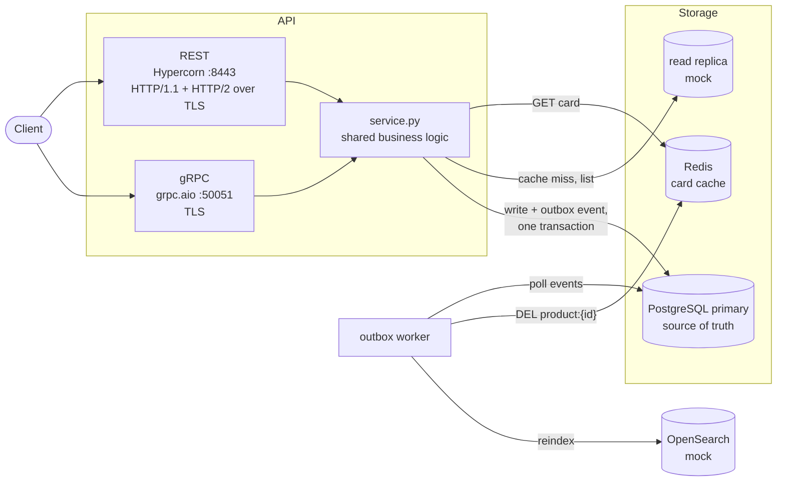
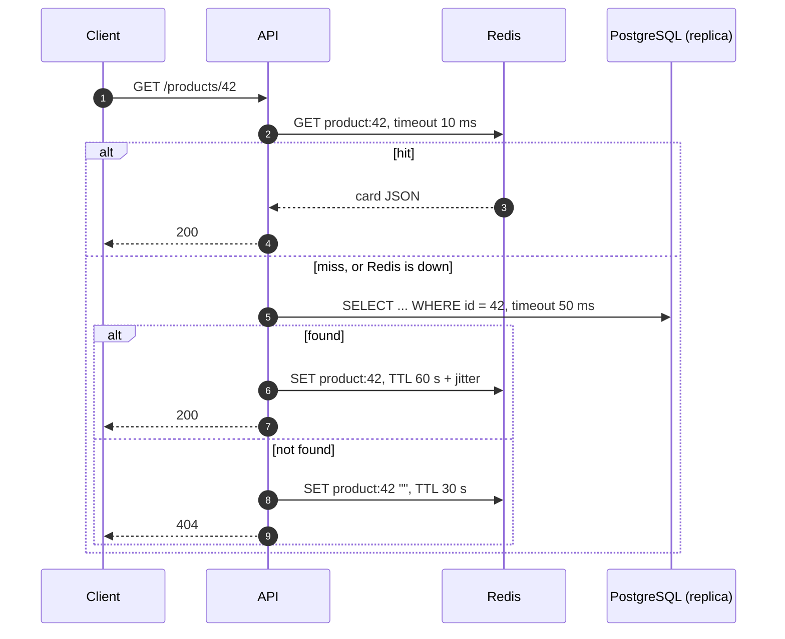
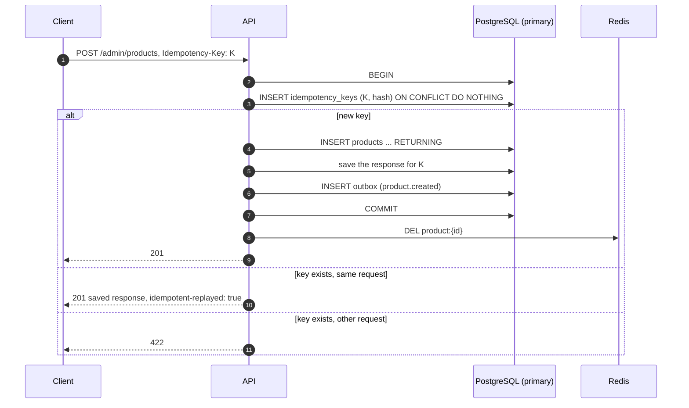
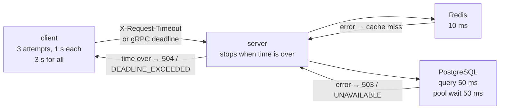
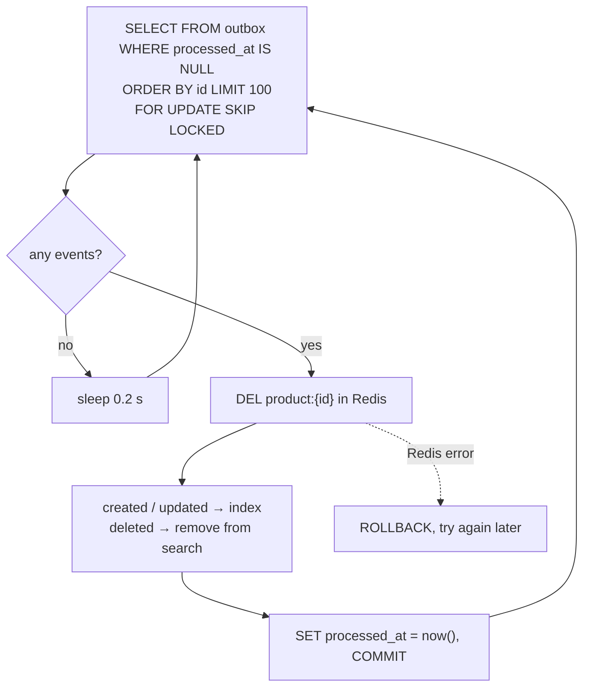
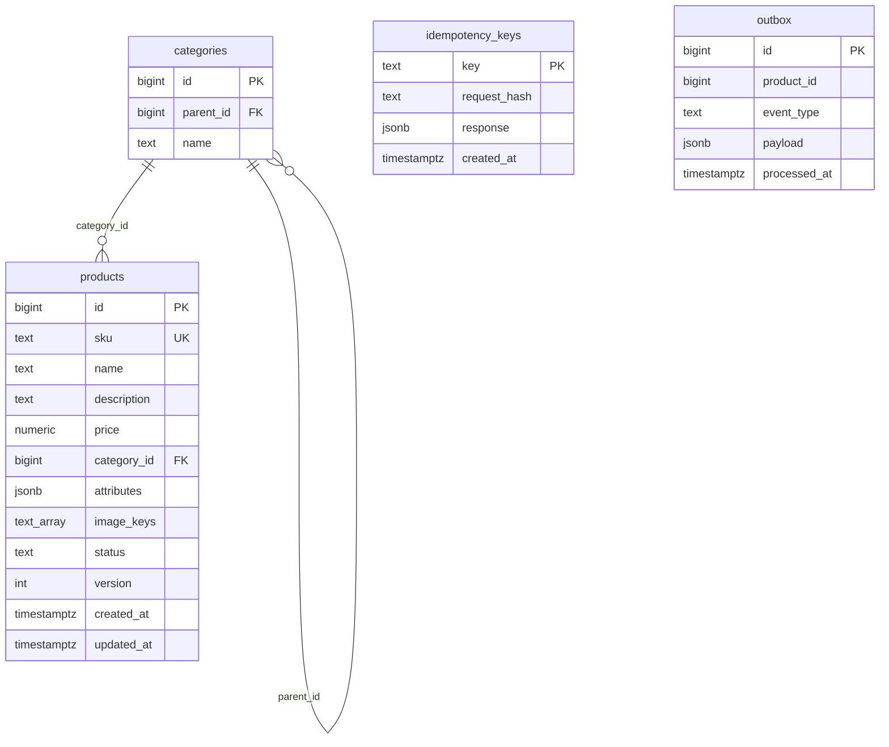

# SIS 2 — Product Catalog

Stack: Python 3.12, FastAPI, Hypercorn, grpc.aio, SQLAlchemy (asyncpg), Alembic, PostgreSQL 17, Redis 7.4.
The service is the product catalog from SIS 1. It speaks three protocols: REST over HTTP/1.1, REST over HTTP/2 and gRPC. All three use the same business logic. Latency and payload numbers are in [REPORT.md](REPORT.md).

## Architecture



Reads are 500× more frequent than writes (SIS 1: 10k read RPS, 20 write RPS). So reads go through a Redis cache, and writes go to one PostgreSQL primary.
Cache data is eventually consistent. After a write the card is deleted from Redis at once. The outbox worker deletes it again within 0.2 s, in case the first delete was lost.

| Part | Code | What it does |
|---|---|---|
| REST | [app/api/rest.py](app/api/rest.py) | REST routes. Maps errors to HTTP codes. `Deadline` middleware stops a request when its time is over |
| gRPC | [app/api/grpc_server.py](app/api/grpc_server.py) | The same operations over gRPC. Maps errors to gRPC codes. Respects the client deadline |
| service | [app/services/service.py](app/services/service.py) | Catalog logic: cache-aside reads, cursor lists, writes with idempotency keys, versions and outbox events |
| cache | [app/cache/cache.py](app/cache/cache.py) | Redis with a 10 ms timeout. Any Redis error is a cache miss |
| database | [app/database](app/database) | Tables and two pools: `Session` for writes (primary), `ReadSession` for reads (replica) |
| outbox worker | [app/workers/outbox_worker.py](app/workers/outbox_worker.py) | A separate process. Reads outbox events, deletes cache keys, reindexes search |
| search | [app/services/search.py](app/services/search.py) | OpenSearch mock, in memory |
| clients | [app/clients.py](app/clients.py) | REST and gRPC clients with timeouts and retries |

### What is real and what is a mock

SIS 1 has more parts. Some of them are mocks here:

| SIS 1 part | Here |
|---|---|
| API pods, PostgreSQL primary, Redis, outbox worker | real |
| PostgreSQL read replicas | mock: a separate pool `READ_DATABASE_URL`. Now it points to the primary. A real replica needs only a new URL |
| OpenSearch | mock: `FakeSearchIndex` in the worker. The list is served from PostgreSQL. This is the SIS 1 fallback mode "OpenSearch down → list from Postgres" |
| Load balancer, CDN, S3, Kubernetes, 3 AZ | not deployed. One REST process and one gRPC process |

## API

| Method | REST | gRPC | Answer |
|---|---|---|---|
| Card | `GET /api/v1/products/{id}` | `GetProduct` | `200` product, `404` |
| List | `GET /api/v1/products?category_id=&price_min=&price_max=&attr.color=&cursor=&limit=20` | `ListProducts` | `{items, next_cursor}` |
| Categories | `GET /api/v1/categories` | `ListCategories` | `[{id, parent_id, name}]` |
| Create | `POST /api/v1/admin/products` | `CreateProduct` | `201` product |
| Update | `PATCH /api/v1/admin/products/{id}` | `UpdateProduct` | `200` product, `412` stale version |
| Delete | `DELETE /api/v1/admin/products/{id}` | `DeleteProduct` | `204` (soft delete) |

- Create and update need an idempotency key: the header `Idempotency-Key` (REST) or the metadata `idempotency-key` (gRPC).
- Update needs the version the client read: `If-Match: <version>` (REST) or `expected_version` (gRPC). In gRPC, `update_mask` lists the fields to change.
- The price is a string, for example `"10.50"`. It is `NUMERIC(12,2)` in the DB, so there is no float rounding.
- Lists use a cursor (`id > cursor`), not `OFFSET`. A far page costs the same as the first one.

| Error | REST | gRPC |
|---|---|---|
| no such product | `404` | `NOT_FOUND` |
| stale version | `412` | `FAILED_PRECONDITION` |
| bad data, or the key was used for another request | `422` | `INVALID_ARGUMENT` |
| SKU is taken, unknown category | `409` | `ALREADY_EXISTS` |
| DB or Redis is slow or down, pool is full | `503` + `Retry-After: 1` | `UNAVAILABLE` |
| the request deadline is over | `504` | `DEADLINE_EXCEEDED` |

The contract is [proto/catalog.proto](proto/catalog.proto). Run `make proto` to make the gRPC code.

## Read



- **Jitter** on the TTL stops many keys from expiring at the same time (avalanche).
- **A cached 404** stops requests for missing ids from hitting the DB (penetration).
- **Redis down** is not an error. The service reads from PostgreSQL.

## Write



Update works the same way. The version check is in the same SQL statement:
`UPDATE products SET ..., version = version + 1 WHERE id = ? AND version = ?`.
If no row changed, a second query tells `404` (no product) from `412` (stale version).

### Why a retry does not write twice

- **Key, product and outbox event are in one transaction.** They are saved together or not at all. If the write fails (for example, the SKU is taken), the key is not saved, and the client can use it again.
- **Two requests with the same key at the same time.** The second `INSERT` waits on the primary key of `idempotency_keys` until the first transaction ends. Then it gets the saved response.
- **The response was lost.** The client sends the same key again and gets the saved response. No second product, no second version bump.
- **A retry over the other protocol.** The hash is made from validated data, not raw bytes. `10.5` and `"10.50"` give the same hash, so a REST request and a gRPC retry match.
- **Delete is safe by itself.** A second delete finds no active row and changes nothing.

## Timeouts and retries



The client tells the server how long it will wait. The server does not work longer, so a slow request frees its DB connection.

| | REST | gRPC |
|---|---|---|
| Retries | `rest_request()`: 3 attempts, pauses ~100 and ~200 ms + jitter | built-in `retryPolicy`: 3 attempts, backoff 0.1 → 0.2 s |
| What is retried | `502`, `503`, `504`, network errors | `UNAVAILABLE` |
| Time limit | 3 s for all attempts and pauses | the call deadline |
| Writes | the same `Idempotency-Key` on every attempt | the same metadata on every attempt |

Retries are tested with fault injection. With `FAULT_INJECTION=true`, the headers `x-fault-id` and `x-fail-times: N` make the server fail exactly the first N attempts.

## Outbox



The API deletes the cache key right after commit. But the process can crash between commit and `DEL`, or Redis can be down. The event stays in `outbox`, and the worker deletes the key later. So an old card can not stay in the cache until the TTL ends.

## Data



| Index | What for |
|---|---|
| `UNIQUE (sku)` | no two products with one SKU |
| `(category_id, id) WHERE status = 'active'` | list by category with a cursor |
| `GIN (attributes jsonb_path_ops)` | filter `attr.color=red` → `attributes @> '{"color":"red"}'` |
| `outbox (id) WHERE processed_at IS NULL` | the worker finds new events fast |

| Redis key | Value | TTL | What for |
|---|---|---|---|
| `product:{id}` | card JSON | 60 s + random 0–12 s | card cache |
| `product:{id}` | `""` | 30 s | cached 404 |

Redis is only a cache. The source of truth is PostgreSQL.

## Run

```bash
uv sync
make up                # PostgreSQL :5432 + Redis :6380 in Docker
make migrate seed      # tables, 100 categories, 10 000 products
make certs proto       # TLS certificate for localhost, gRPC code

make rest-tls          # REST  https://localhost:8443
make grpc              # gRPC  localhost:50051
make outbox            # outbox worker

make test              # 27 integration tests, they start the servers
make bench             # benchmark → benchmarks/
```

`make seed COUNT=1000000` loads 1M products. `make rest` runs REST without TLS on `http://127.0.0.1:8000/docs`.

### Fault tolerance

| What breaks | What happens |
|---|---|
| Redis is slow or down | Reads go to PostgreSQL. Writes still work. The worker retries the cache delete |
| PostgreSQL is slow (> 50 ms) or the pool is full | `503` + `Retry-After` / `UNAVAILABLE`. The client retries |
| PostgreSQL is down | Writes and cache misses answer `503` / `UNAVAILABLE`. Cache hits still work |
| The API crashes after commit, before `DEL` | The outbox event stays. The worker deletes the key |
| The outbox worker is down | Events wait in the table. The fast `DEL` still works. Search is updated when the worker is back |
| The response to a write is lost | The client retries with the same key and gets the saved response |
| The client deadline is over | The server stops and answers `504` / `DEADLINE_EXCEEDED` |

### Test by hand

```bash
API=https://localhost:8443/api/v1
CA="--cacert certs/cert.pem"

# the protocol is chosen by ALPN
curl -s -o /dev/null -w "%{http_version}\n" --http1.1 $CA $API/products/1
curl -s -o /dev/null -w "%{http_version}\n" --http2   $CA $API/products/1

# idempotency: the second answer has the same id and idempotent-replayed: true
for i in 1 2; do
  curl -si $CA -X POST $API/admin/products \
    -H "Idempotency-Key: demo-key-0001" -H "Content-Type: application/json" \
    -d '{"sku":"DEMO-1","name":"Lamp","price":"10.50","category_id":12}' | grep -iE "^HTTP|replayed"
done

# optimistic locking: the second PATCH with version 1 gets 412
curl -s -o /dev/null -w "%{http_code}\n" $CA -X PATCH $API/admin/products/1 \
  -H "Idempotency-Key: demo-key-0002" -H "If-Match: 1" -H "Content-Type: application/json" -d '{"name":"A"}'
curl -s -o /dev/null -w "%{http_code}\n" $CA -X PATCH $API/admin/products/1 \
  -H "Idempotency-Key: demo-key-0003" -H "If-Match: 1" -H "Content-Type: application/json" -d '{"name":"B"}'
```

## Settings

All settings are in `.env` ([.env.example](.env.example)), read by [app/config.py](app/config.py).

| Variable | Default | What for |
|---|---|---|
| `DATABASE_URL` | `postgresql+asyncpg://…@127.0.0.1:5432/catalog` | primary, writes |
| `READ_DATABASE_URL` | same as `DATABASE_URL` | replica, reads |
| `REDIS_URL` | `redis://127.0.0.1:6380/0` | cache |
| `REDIS_TIMEOUT` | 0.010 | Redis command timeout, s |
| `DB_TIMEOUT` | 0.050 | SQL query and pool wait timeout, s |
| `CACHE_TTL` | 60 | card TTL, s (+ up to 20% jitter) |
| `CACHNE_NOT_TTL` | 30 | cached 404 TTL, s |
| `CACHE_ENABLED` | true | `false` for the benchmark without cache |
| `REQUEST_TIMEOUT` | 3.0 | max server time for one REST request, s |
| `GRPC_BIND` / `GRPC_TARGET` | `127.0.0.1:50051` / `localhost:50051` | gRPC server and client address |
| `REST_URL` | `https://localhost:8443` | REST client address |
| `TLS_CERT` / `TLS_KEY` | `certs/cert.pem` / `certs/key.pem` | TLS for REST and gRPC |
| `OUTBOX_POLL_INTERVAL` | 0.2 | worker pause when there are no events, s |
| `FAULT_INJECTION` | false | only for tests: makes `x-fail-times` work |

REST on `:8443` is set in [hypercorn.toml](hypercorn.toml). It also sets `keep_alive_max_requests = 1000000`: by default Hypercorn closes an HTTP/2 connection after 1000 requests, and requests in flight fail.

## Layout

```
app/
  api/          rest.py, grpc_server.py, gRPC code from make proto
  services/     service.py (business logic), search.py (OpenSearch mock)
  database/     db.py (pools), models.py (tables)
  cache/        cache.py
  workers/      outbox_worker.py
  config.py     settings
  schemas.py    Pydantic models
  clients.py    clients with timeouts and retries
proto/          catalog.proto
migrations/     Alembic
tests/          integration tests
bench.py        benchmark, devservers.py starts servers for tests and benchmark
```
